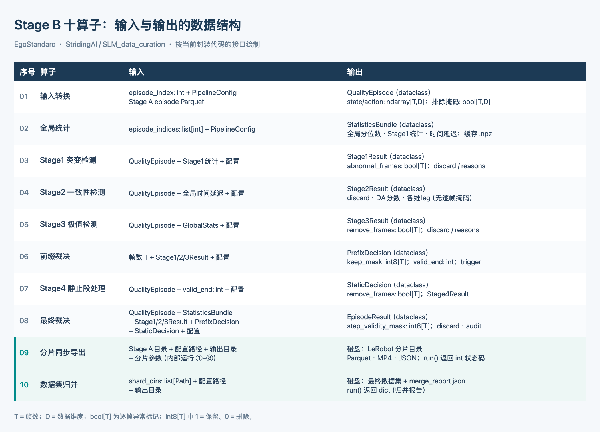

# Stage B：十算子封装

本目录整理 `StridingAI/SLM_data_curation` 的 **EgoStandard Stage B**。算法复用上游
`robot_data_processing`；此目录只负责明确算子边界和编排，不修改 Stage A 输入。
当前对照的上游版本是 `main` 的 `0e694db`。运行时应使用同一版本，以免上游接口漂移。

## 算子与执行顺序



| # | 算子 | 输入 → 输出 | 实现 |
|---|---|---|---|
| 1 | 数据读取与质量空间转换 | Stage A episode → `QualityEpisode` | `operators/input_adapter.py` |
| 2 | 全局统计 | episode 集合 → Stage1 阈值、Stage3 分位数、P4 lag | `operators/statistics.py` |
| 3 | Stage1 突变检测 | episode + Stage1 阈值 → `Stage1Result` | `operators/stage1.py` |
| 4 | Stage2 状态动作一致性 | episode + lag → `Stage2Result` | `operators/stage2.py` |
| 5 | Stage3 极值检测 | episode + 分位数 → `Stage3Result` | `operators/stage3.py` |
| 6 | 前缀裁决 | Stage1–3 结果 → `PrefixDecision` | `operators/prefix.py` |
| 7 | Stage4 静止段缩短 | episode 的有效前缀 → `StaticDecision` | `operators/stage4.py` |
| 8 | 最终裁决 | 前缀、静止段和尾部规则 → `EpisodeResult` | `operators/decision.py` |
| 9 | 分片同步导出 | `EpisodeResult` + Stage A → parquet、视频、报告 | `operators/export.py` |
| 10 | 数据集归并 | 分片 → 最终数据集及相对统计 | `operators/aggregate.py` |

`operators.yaml` 给出机器可读的输入输出清单。Stage1–4 各有独立 Python 类和 `run()`。
Stage2 的可选 `action.eef` 填充只改临时字段字典。Stage5 当前默认关闭，沿用上游可选实现。
前缀截断、Stage4 稀疏删帧、短 episode 丢弃和审计字段与上游保持一致。

## 依赖与运行

需要 Python 3.10+、上游 `qwen-manip-preprocess` 的依赖，以及视频导出所需的 FFmpeg。
代码默认使用同级 `upstream/SLM_data_curation` 源码快照，或工作区中的 Git 检出；
也可以通过 `--repo-root` / `SLM_DATA_CURATION_ROOT` 指向别的检出。

```bash
python run.py --repo-root /path/to/SLM_data_curation run \
  --input-root /path/to/stage_a_aligned \
  --output-dir /path/to/stage_b_operator_run \
  --sample-size 10 --workers 4 --output-mode report
```

只检查 Stage1–4 并生成质量报告时，可直接运行算子 1–8。这个入口不读取视频，
也不需要 FFmpeg：

```bash
python run.py quality --input-root /path/to/stage_a_aligned \
  --output-dir /path/to/quality_report --sample-size 10 --workers 4
```

全量分片沿用上游的共享统计策略：先运行 `--stats-only --stats-cache-dir <dir>`；
然后对每个分片运行 `--shard-id i --num-shards N --stats-cache-dir <dir>
--export-shard-only`。最后：

```bash
python run.py --repo-root /path/to/SLM_data_curation merge \
  --config /path/to/SLM_data_curation/datasets/Egostandard/run_config_stage_b.yaml \
  --shard-dir /path/to/shard_0 --shard-dir /path/to/shard_1 \
  --output-dir /path/to/stage_b_cleaned
```

不传 `--input-root` 时使用上游 `run_config_stage_b.yaml` 的输入目录。质量阈值仍由上游
`datasets/Egostandard/quality.yaml` 提供。`run` 命令不执行 `merge`，避免意外把分片写入
最终目录。运行时输出 `quality_report.json`、`exclusion_log.jsonl`，导出时继续生成上游的
`frame_removal.json`、`episode_discard.json` 等审计文件。

## 验证

`tests/test_parity.py` 使用真实 parquet 小样本比较原版与算子版的每条 episode 判定、
逐帧保留掩码、审计指标，并比较两套完整统计与报告流程的结果。

```bash
PYTHONPATH=/path/to/SLM_data_curation/qwen-manip-preprocess/src:\
/path/to/ryk/slm_data_curation python -m pytest -q tests/test_parity.py
```

当前本地没有完整 Stage A 数据集和 FFmpeg；视频导出、分片归并还需要在开发机上做
小样本验收。

开发机 `ryk` 部署路径为 `/mnt/pfs/Data/ryk/slm_data_curation/`。2026-10-15 已用
`Egostandard_stageA_261012` 的前 2 条 episode 完成 `quality` 实测：1796 帧进入报告，
两条都保留。完整 `run` 的视频检查需要 `ffprobe`，视频导出还需要 `ffmpeg`；
当前开发机环境未提供这两个命令，因此尚未做视频导出与归并实测。
